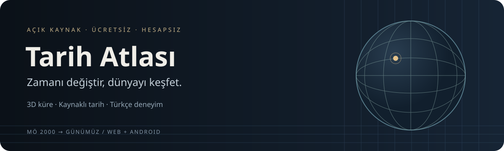

<p align="center">
  
</p>

<p align="center">
  <a href="LICENSE"></a>
  
  
  
</p>

<p align="center">
  <a href="#kurulum">Kurulum</a> ·
  <a href="#neler-yapabilirsin">Özellikler</a> ·
  <a href="#veri-kapsamı">Veri kapsamı</a> ·
  <a href="docs/docker.md">Docker / Releases</a> ·
  <a href="#katkıda-bulun">Katkıda bulun</a>
</p>

# Tarih Atlası

**Dünya tarihini, döndürülebilir bir 3D küre üzerinde keşfet.** Yılı değiştir;
siyasi oluşumları, kültürleri, tarihî kişileri, savaşları ve olayları kaynaklarıyla
incele. Bir kaydın kısa bilgisinden doğrulanmış Wikipedia bağlantısına ulaş.

Tarih Atlası; **ücretsiz, açık kaynaklı, hesapsız ve Türkçe öncelikli** bir tarih
atlasıdır. Harita ana çalışma alanıdır: tarih, arama, katmanlar ve bilgi kartları
aynı dünya üzerinde birleşir. Web ve Android için React Native + Expo ile geliştirilir.
Reklam, puan, rozet veya oyunlaştırma yoktur.

> **Teknik önizleme:** Uygulama geliştirme aşamasındadır. Her yıl ve her bölge için
> eksiksiz tarihî veri sunmaz. Bilinen yayın engelleri, veri belirsizlikleri ve
> Android cihaz doğrulamasının durumu [açıkça belgelenir](docs/release-blockers.md).
> İlk hazır Release yayımlanana kadar kaynak koddan kurulum kullanılabilir.

## Neler yapabilirsin?

| Keşif                      | Deneyim                                                                                                                                                  |
| -------------------------- | -------------------------------------------------------------------------------------------------------------------------------------------------------- |
| **Dünyayı gez**            | Gerçek MapLibre 3D küreyi döndür, yakınlaş, uzaklaş ve kamerayı sıfırla. Yeni kurulum Türkiye çevresinde, 2024 yılıyla başlar.                           |
| **Tarihi değiştir**        | MÖ 2000–günümüz aralığında yıl seç; ileri/geri atla veya zamanı oynat. Arayüzde yıl sıfır yoktur.                                                        |
| **Katmanları yönet**       | Devletler, kültürler, kişiler, savaşlar, olaylar ve uygun yer etiketlerini birbirinden bağımsız açıp kapat.                                              |
| **Ara ve odaklan**         | Türkçe karakterler ve alternatif adlarla yerel katalogda ara. İlgili yıla geçişi kendin seç.                                                             |
| **Kaynağa ulaş**           | Kısa bilgi, dönem, konum ilişkisi ve belirsizliği incele; mevcut Türkçe Wikipedia sayfasını, yoksa kontrollü dil/Wikidata alternatifini aç.              |
| **Yerleri keşfet**         | Güncel şehir, yerleşim ve ilçe/idari birim referans noktalarını yakınlaşma düzeyine göre göster. İsteğe bağlı güncel yolları aç.                         |
| **Kendi atlasını oluştur** | Yer imlerini ve görünümü yerelde sakla; haritada seçtiğin noktaya kişisel kişi/savaş/olay notu ekle. Kişisel notlar doğrulanmış katalogdan ayrı tutulur. |
| **Paylaş**                 | Seçili yıl, kayıt ve kamera bağlamını içeren bağlantı oluştur.                                                                                           |

Küre ve dokunmatik arayüz aynı alan modelini kullanır. Kültürel etki alanı siyasi
egemenlik sınırı olarak sunulmaz; kaynağı olmayan kişi konumu haritaya yerleştirilmez.

## Kurulum

### Docker ile

Bilgisayarında **Docker Desktop** veya **Docker Engine + Compose v2** varsa Node.js
kurmadan derleyip başlatabilirsin:

```sh
git clone https://github.com/Teknoloji-Filozoflari/Tarih_Atlasi.git
cd Tarih_Atlasi
docker compose up -d --build --wait
```

**http://127.0.0.1:8081** adresini aç. İlk kurulum internet ve veri katalogları için
disk alanı gerektirir. Uygulama ve incelenmiş veri parçaları imajın içinde tutulur;
çalışırken bir Expo geliştirme sunucusuna ihtiyaç duymaz.

Durdurmak için `docker compose down`; durum ve hata kaydı için
`docker compose ps` ve `docker compose logs --tail=100` kullanılır.

### Releases'ten hazır kurulum

[Yayımlanmış önizleme sürümleri](https://github.com/Teknoloji-Filozoflari/Tarih_Atlasi/releases)
varsa, kaynak kodunu derlemek yerine hazır paketi alabilirsin:

| İndirme                                          | Gerekenler                                    | Başlatma                                  |
| ------------------------------------------------ | --------------------------------------------- | ----------------------------------------- |
| `tarih-atlasi-docker-linux-amd64-<sürüm>.tar.gz` | Docker; x64 Linux veya Windows Docker Desktop | Arşivi aç → `sh Kur.sh` / `Kur.cmd`       |
| `tarih-atlasi-web-<sürüm>.tar.gz`                | Node.js 24 veya 26                            | Arşivi aç → `sh Baslat.sh` / `Baslat.cmd` |

Aynı Release'in **SHA256SUMS** dosyasıyla indirmeyi doğrula. Hazır Docker paketi
`docker load` ile kurulabilir; bir registry hesabı gerekmez. Henüz yayımlanmamış
taslaklar herkese görünmez. Android APK şu an dağıtımın parçası değildir.

[Port değiştirme, güncelleme, kayıtların korunması ve ayrıntılı kurulum →](docs/docker.md)

### Geliştirici olarak

**Node.js 24 LTS** (`.nvmrc`) ve **npm 12.2.0** kullanılır. Node 26 da manifestte desteklenir.

```sh
npm install --global npm@12.2.0
npm ci
npm run web -- --host localhost --port 8081
```

Bu depo uygulamanın incelenmiş veri çıktılarını içerir; ilk çalıştırma için bütün
Wikidata/GeoNames arşivini yeniden indirmen gerekmez. Ham veri edinimi ayrı bir
bakım işidir ve otomatik yayın onayı değildir.

Derlenmiş web sürümünü yerelde denemek için:

```sh
npm run web:export
npm run web:serve
```

[Android SDK, Linux/CachyOS, USB cihaz ve geliştirme rehberi →](docs/development.md)

## Veri kapsamı

**Tarih seçebilmek, o yıl için eksiksiz veri bulunduğu anlamına gelmez.** Destekli
kaynak yılı, yaklaşık rekonstrüksiyon ve veri bulunmayan dönem ayrı gösterilir.
Boş bir alan “burada devlet/insan yoktu” iddiası değildir.

21 Ekim 2026 tarihli yerel katalog sayımı:

| İçerik                             | Kapsam ve sınırı                                                                                                                                                         |
| ---------------------------------- | ------------------------------------------------------------------------------------------------------------------------------------------------------------------------ |
| **3.203 kişi profili**             | Bilim, felsefe, din, siyaset ve kültürden kaynaklı kayıtlar. Hepsinin yıllık konumu doğrulanmış değildir.                                                                |
| **193 doğum yılı noktası**         | Yalnız kaynaklı doğum yılına bağlı, yaklaşık yer temsil noktaları. Kişinin tüm yaşamı boyunca burada bulunduğunu göstermez.                                              |
| **1.120 olay**                     | Kaynağı bulunan savaş, muharebe ve diğer olay kayıtları. Konumsuz veya tarihi eksik olan kayıtlar için nokta/tarih uydurulmaz.                                           |
| **5.616.753 güncel coğrafi kayıt** | GeoNames'ten yerleşim ve idari birim noktaları; 248 ülke/bölge kodu. Günümüz referansıdır; bütün ilçelerin sınır poligonları değildir.                                   |
| **Tarihî siyasi coğrafya**         | Cliopatria rekonstrüksiyonları ve incelenmiş pilotlar. Kaynak aralıkları ve sorunlu/eksik geometriler korunur; her yıl için doğrulanmış dünya haritası garantisi yoktur. |
| **Fiziksel taban**                 | Natural Earth kara, göl ve nehir ayrıntısı. Güncel kıyı/coğrafya, tarihî fiziksel coğrafya iddiası taşımaz.                                                              |
| **Kültür ve yol katmanları**       | Kültür geometrileri ancak uygun kaynak bulunduğunda eklenir. İsteğe bağlı yol katmanı günceldir; geçmişteki yolları göstermez.                                           |

Katalog büyük olsa da “dünya tarihindeki tüm önemli kişiler/savaşlar” tamamlanmış
sayılmaz. Kaynak doğrulaması, yıl hassasiyeti ve yeniden dağıtım hakkı ayrı kapılardır.

[Kapsama stratejisi](docs/coverage-strategy.md) · [Veri kalitesi](docs/data-quality.md) ·
[Kaynak matrisi](docs/source-matrix.md) · [Son içerik incelemesi](docs/reports/history-import-2026-10-21.md)

## Kaynaklar ve lisanslar

**Uygulama kodu MIT lisanslıdır. Veri, font, harita motoru ve dış servislerin hakları ayrıdır.**

| Kaynak                      | Kullanımı                                                | Hak / atıf                                                                               |
| --------------------------- | -------------------------------------------------------- | ---------------------------------------------------------------------------------------- |
| Natural Earth               | Fiziksel kara ve su tabanı                               | Public domain; kaynak bildirimi korunur.                                                 |
| Cliopatria / Seshat         | Tarihî coğrafya rekonstrüksiyonları                      | CC BY 4.0; sürüm, yazar/kaynak ve değişiklik bilgisi korunur.                            |
| Wikidata                    | Yapılandırılmış kişi/olay olguları ve mevcut sitelinkler | CC0; kaynak kimlikleri ve revizyonlar izlenir.                                           |
| GeoNames                    | Güncel yerleşim ve idari referans noktaları              | CC BY 4.0; tarihî konum kanıtı sayılmaz.                                                 |
| OpenFreeMap / OpenStreetMap | İsteğe bağlı güncel yollar                               | Servis koşulları ve OSM ODbL/atıf şartları ayrı uygulanır; offline tile paketi eklenmez. |
| MapLibre GL JS              | Ortak 3D harita motoru                                   | BSD-3-Clause.                                                                            |

Wikipedia makaleleri ve Commons görselleri **Wikidata CC0 kapsamında değildir**.
Bağlantılar başlık tahminiyle üretilmez; doğrulanmış sitelink kullanılır. Lisansı
belirsiz Historical Basemaps verisi dağıtıma alınmaz. OHM verisinin kabulü nesne
bazında hak/zaman incelemesi gerektirir.

[Tüm üçüncü taraf bildirimleri](THIRD_PARTY_NOTICES.md) · [Lisans sicili](docs/license-register.md) ·
[Atıf denetimi](docs/attribution-audit.md)

## Gizlilik ve yerel kayıtlar

Hesap, reklam veya eklenmiş analytics/telemetri sistemi yoktur. Arama öncelikle yerel
indekste çalışır. Yer imleri, tercihler ve kişisel notlar cihaz/tarayıcıda tutulur.
Tarayıcı verisini silmek bunları silebilir; farklı port/adres farklı depolama alanıdır.

Wikipedia'ya gittiğinde veya güncel yolları açtığında ilgili dış servise bağlanırsın.
Kaynak bağlantısı yenilemeleri ağ kullanabilir. Bu yüzden tam çevrimdışı kullanım
sözü verilmez. [Gerçek davranışa göre gizlilik politikası →](docs/privacy-policy.md)

## Teknik yapı ve kontroller

React Native / Expo Router / TypeScript strict; web'de doğrudan MapLibre GL JS,
Android'de aynı küre çekirdeği için DOM/WebView adaptörü. Zorunlu backend yoktur.
Sürümlü manifest, checksum, kaynak ve lisans kapılarıyla statik veri yüklenir.

```text
src/app/            Uygulama girişleri ve navigasyon
src/atlas/          Harita, paneller, timeline ve kullanıcı akışları
src/domain/         Tarihî alan modeli ve kaynak doğrulaması
src/timeline/       MÖ/MS hesapları, sorgular ve oynatma
src/map/            Ortak küre çekirdeği, web/native adaptörleri
src/data/           Kaynak politikası, coğrafi katalog ve sağlayıcılar
src/history/        Bölümlenmiş kişi/olay arşivi
src/places/         Güncel şehir/idari referanslar
assets/            İncelenmiş veri parçaları ve lisanslar
scripts/           ETL, kontroller ve dağıtım araçları
tests/             Birim, entegrasyon ve browser senaryoları
docs/              Mimari kararlar, kaynaklar ve test kanıtları
```

```sh
npm run check                  # lint, strict tip kontrolü, test ve veri kapıları
npm run web:export             # statik web derlemesi + hash kontrollü şehir paketleri
npm run test:web:production    # Playwright ile gerçek web akışları
npm run android:bundle         # yalnız Android JS/asset export; APK değildir
```

Browser testleri için önce `npx playwright install chromium` gerekir. Gerçek Android
cihaz kabulü ve ölçülmemiş performans sayıları test raporunda doğrulandı sayılmaz.
[Güncel ilerleme ve çalıştırılan kontroller](docs/progress.md) ·
[Mimari](docs/architecture.md) · [Ürün gereksinimleri](docs/product-requirements.md)

## Katkıda bulun

Bir eksik ülke, kişi veya olay bildirebilirsin. [Issue açarken](https://github.com/Teknoloji-Filozoflari/Tarih_Atlasi/issues)
**seçili yıl, bölge/kayıt adı, beklenen davranış ve doğrudan kaynak bağlantısı** ekle.
Tarihî veri katkısı için lisans, tarih hassasiyeti ve konum kanıtı gerekir.

Kod katkılarında mevcut akışları koru, Türkçe metinleri i18n kataloğuna ekle ve
ilgili kontrolleri çalıştır. [Katkı rehberi](CONTRIBUTING.md) ve [AGENTS.md](AGENTS.md)
uygulanır. Yeni veriler incelemeden üretim kataloğuna otomatik katılmaz.

---

**Tarih Atlası** — Tarihi keşfet; kaynağı ve belirsizliği görerek.
