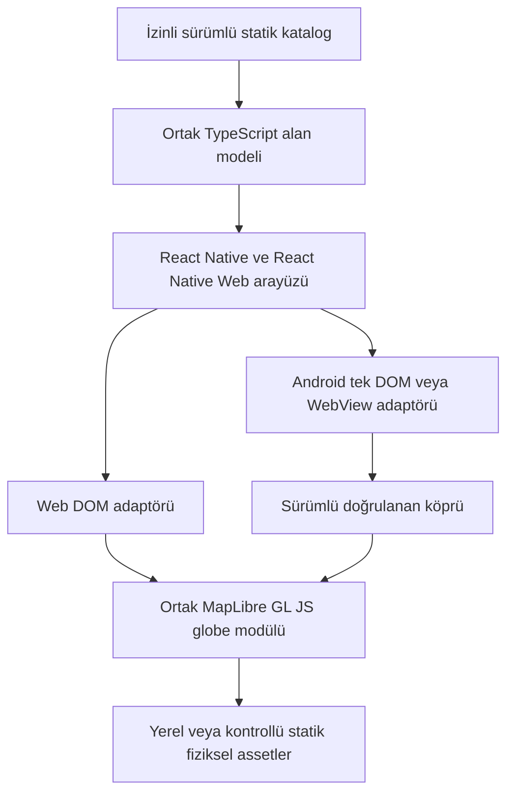

# Teknik uygulanabilirlik ve mimari

## 21 Ekim — Kademeli kişi/olay kataloğu

İndirilen kaynaklar mevcut küçük pilot/people extension sınırları artırılmadan
ayrı pinlenmiş manifest ve 338 küçük asset üzerinden bağlandı. Başlangıçta
ad/tür/yıl indeksi, ihtiyaçta lisans/hash/şema doğrulamalı ayrıntı/geometri;
web/native aynı MapLibre globe ve eski bridge protokolü korunur. Yeni bağımlılık
yok. Eski sağlayıcılar/zaman motoru yerinde kalır; siyasi bağlam binlerce yeni
kişi kimliğiyle yüklenmez. [ADR0019](adr/0019-indexed-history-catalog.md).

## Güncel yol katmanı — 18 Ekim 2026

Aynı MapLibre globe çekirdeğine opsiyonel güncel OpenFreeMap/OSM vektör katmanı
eklendi. Yerel fiziksel/historical style guard korunur; uzak hazır style veya
modern siyasi label/boundary yüklenmez. Dar HTTPS XYZ allowlist, görünür atıf,
20 sn hata fallback'i, 128 tile cache sınırı, arka plan/unmount temizliği vardır.
Native navigasyon/file izinleri değişmez; CORS/cihaz doğrulaması açık.
[Karar, kapsam ve testler](reports/atlas-colors-roads.md).

## 18 Ekim 2026 — Dünya şehir verisiyle web paketleme sınırı

Kurulu GeoNames kataloğu16.102pakettir. Browser `reader.web.ts` yalnız aynı
originHTTPveri okur; nativeasset/gzipmodülleri browser grafiğinde yoktur.
Metro geliştirmede onaylı SHA yolları için kontrollü statik middleware,
webexportta doğrulanmış paket/NOTICEkopyası kullanılır. Veri kökü
`/data/places/<sha256>.atlas`; backend, harici servis veya APIanahtarı gerekmez.
HTTPokumasında boyut/iptal/origin, repository'de sürüm/SHA/rowşeması kontrolü
sürer; fetch redirecterror/credentialsomit, önbellek politikası hashimmutable.

`GlobeDOM` aynı `GlobeView` çekirdeğine ayrı DOMprovider verir; nativeUI ve
DOMdosya-originadaptörleri korunur. Köprü şeması/4096bytezarf/navigasyon ve
WebView izinleri değiştirilmedi. Nativebüyük veri paketleme/cihaz riski açık.

Manifest TSnesne literalinde16binden fazla altküme için unionçıkarmak yerine
JSONverisi olarak yüklenir. Strictuygulama tipleri ve bütün runtimeprotokol
kontrolleri sürer; şema, row, SHA ve lisans limitleri yükseltilmedi.
Saf gzip-stringgeneratedmodülleri ESLint'te tekrar parseedilmez; tam içerikleri
`places:check` içinde regex/decodedveri/SHA ile doğrulanır. Loader ve uygulama
kodu lintkapsamındadır. Staging/eskigenerator yedekleri Metrographdışındadır.
[Gerçek veri/derleme kanıtları](reports/metro-places.md).

## 18 Ekim 2026 — Üçüncü kişi release'i ve doğum belirsizliği

Runtime 1.0.1/1.1.1/1.2.0-births sürümlerini aynı provider'a ekler. Yeni
Osmanlı release'i 5 katalog/96 domain kayıt/50 source ID'dir; kayıt ID'leri
benzersiz, ham SHA ve sürüm onayı koddan gelir. İstek araması ve doğum kartı
üç manifesti kullanır. İstek metadata'sı domain kaydı yerine geçmez.

Üretici P569 circa/disputed/presumably/uncertain niteleyicilerini biyografik
karara da taşır; yalnız zaman alanını belirsiz işaretleyip yıllık nokta üretmez.
Kanuni için 1494/1496 ayrışması editöryal karardadır. Şehir ve saray site
ölçeği ayrılır; eksik P625 şehir merkeziyle doldurulmaz. Açık editöryal kısa
açıklama ham kaynak iddiasını silmeden çelişkiyi anlatabilir.

Her release <=16 katalog/512 kayıt; paket <=256KiB, birleşik extension <=800,
arama/timeline <=1000 kayıt sınırları değişmedi. Yeni ek bağımlılık yok.
665 kişinin tamamını üretime alma için kaynak incelemesi ve mevcut chunk
altyapısına uygun indeks çalışması hâlâ gerekir; bütçeler yükseltilmedi.
[Kanıt raporu](reports/ottoman-people.md). Aşağıdaki kayıtlar önceki kararlardır.

## 18 Ekim 2026 — Geniş kişi isteği ve ayrı ek release

823 istek içeren metadata indeksi yayımlanmış kişi domain kayıtlarından
ayrıdır. `request-search.ts` kullanıcı yazımlarını yalnız arama terimlerine
ekler; kaynak adını veya evidence'ı değiştirmez. Kaynak bekleyenler 8 satırlık
ayrı listede, 9 atlanan belirsiz ad ise arama/toplama dışında kalır.

1.1.0-births ek release: 29 kişi, 86 kayıt, 4 katalog; ayrı ham SHA/sürüm/atıf
kontrolü. `combinePeopleExtensions` her release'in hak/boyut sınırını korur;
yinelenen ID'yi reddeder, birleşik extension 800 kayıtla sınırlıdır. Mevcut
timeline 1000 kayıt bütçesi değişmez. Tam 698 kişinin üretim verisi bu küçük
kataloğa zorla sığdırılmaz; mevcut chunk altyapısına bağlı ek indeks işi gerekir.

Timeline bilinmeyen yaşam sonunu doldurmaz. Kaynaklı tek doğum yılına, yalnız
o yıl için kişi desteği ekler; günümüzde yaşama veya ikamet çıkarımı yoktur.
Köprü/renderer şekli değişmedi. ETL collector tek istek/cache/receipt/limit ve
retry ile staging veri toplar, otomatik üretim onayı vermez.
[Kapsam ve kalanlar](people-expansion.md), [test kanıtları](reports/requested-people.md).

## 18 Ekim 2026 — Doğum katalogları

`src/people/extension.ts` 14 ayrı domain/lisans doğrulamasından geçen katalog
sunucusunu mevcut provider ile birleştirir. Her paket <=256KiB, toplam 308 kayıt;
yerel pilot 106 kayıt/512KiB ve her katalogdaki64girdi sınırı korunur. Ortak
arama projeksiyonu 392 kayıt; doğrulanmamış dev katalog yaratmak için validator
atlatılmaz. 1.0.0-births release her pakette SHA/boyut ve iki editöryal girdi için
kodda onaylı SHA taşır. bootstrap/bridge/chunk0.7.0-discovery bağlamı korunur;
eski first-ten kişi/iki doğum marker ID'si yeni kayıtlarla tekil olarak düzeltilir.

Kişi repository/timeline/search/source ekranları ve web/native ortak renderer
aynı doğrulanmış provider'ı kullanır. Yalnız extension'ın doğruladığı inline
kişi geometrileri chunk yüklemede tanınır; varsayılan kontrol hâlâ reddeder.
İç içe metadata/koordinatlar immutable kopyadır. Native uyumu için JSON kopyası,
global structuredClone gereksinimi yok. Her konum yalnız kendi snapshot yılı;
biyografik kayıtlar yıllık feature akışına katılmaz. Kümeleme/filtreler korunur.
Yeni paketler statik küçük nokta kataloğudur (1.17MB JSON); ilk yüke ek maliyet
getirir, sınırsız kişi/veri çözümü değildir. 512kayıt/16katalog ve sorgu/paging
kotaları ile sınırlandırılır. Daha büyük içeriğe geçiş mevcut chunking hattıyla
ölçüm gerektirir. [Kaynaklar, kapsam ve doğrulamalar](reports/person-births.md).

## 18 Ekim 2026 — Dünya güncel yerleşim/idari nokta kataloğu

`src/places` tarihî domain/provider'dan ayrı GeoNames manifest, chunk doğrulayıcı,
coğrafi+LOD seçici ve iki platform okuyucusunu içerir. Aynı MapLibre kürede
yerleşim/idari nokta etiketleri; native DOM köprüsünde yalnız sürümlü kimlik+paket
referansı. Host veriyi hash doğrulamalı yerel kaynaktan çözer; geometri/worldlist
taşınmaz. Modern yıl geçerliliği üretilmez; harita 32etiketle sınırlı, çizilmeyen
kayıtlar ülke bazında sayfalı listeden erişilir. Native privateassetcache refcount
ile dünya geometrisi/şehirler için ortak. Tüm dünya indirilince bundle boyutu ve
gerçek cihaz ölçümü zorunlu; bu ortamda EAI_AGAIN nedeniyle dataset yok.
[Kapsam, kurulum, güvenlik ve sınırlamalar](modern-places.md).

## 18 Ekim 2026 — Türkiye kamerası ve tarihî/güncel keşif ayrımı

Tek MapLibre globe/web+tekExpoDOM sürer. INITIAL_CAMERA35D39K/zoom1.4
(küre-okunur ev; eski zoom4 bölgesel açılış küreyi gizliyordu); açık
SavedView/cameraRequest daha öncelikli. Güncel şehirler HistoricalPlace ve
historicalFeatures dışında altı kayıtlık yerel modernCitySnapshot modülüdür.
city.selected version1 zarfı yalnız incelenmiş ID kabul eder; URL/geometri yok.
modernCities isteğe bağlı tercih booleanı eskiversion1tercihleri bozmaz.

Kişi+olay markerları ortak bounded kümelenir (1000/64); grid komşu hedefleri
birleştirilir, gerçek kaynak üyesi anchor kalır. StaticSVG/DOMtextContent;
innerHTML yok. Kartların uzun metni RecordDetails/SourceActions altında.
CAMPAIGN, muharebe/savaş ile karıştırılmadan savaş katmanına bağlanır.

0.7.0-discovery kaynak/hak kontrollü bootstrap106kayıt,425675byte;35input
nedeniyle toplaminput64üst sınırı.32transform girdisi/32chunkkaynak kapanışı/
512KiBbootstrap/256KiBchunk sınırları değişmedi.86manifestgirdisi/44chunk.
WorldInlineVerifier yalnız doğrulanmışrepository'deki pack veya incelenmiş
geometryKey'i tanır; Libya/Çad supplementinin yanlış CHUNK_GEOMETRY reddi
burada giderildi. Ham/374immutable dünya varlıkları korunur.
[Kanıt ve sınırlamalar](reports/turkey-discovery.md).

## 18 Ekim 2026 — kısa adlar ve dar ülke incelemesi

`politics/short-names.ts` açık kısa ad eşleştirmesini ortak siyasi ad, arama ve
kayıt listesinde uygular. Kaynak ad/ID/değerlendirme saklı; tarihî adlar regex
ile silinmez. Kartın uzun kaynakları kapalı SourceActions içinde, cache/kapsam
Keşfet'te; timeline araçları mevcut EntitySheet/Modal üzerinden açılır. Tek
MapLibre globe/tek nativeDOM/aynı zaman motoru kararı değişmedi.

İnceleme1.1.0 ham paketleri değiştirmez. Ek üç satırın `countryReviewJson` hash'i
ve NOTICE ayrı pinlidir; `reviewedGeometryKey` yalnız incelenmiş uygulama
metaverisindedir. Aynı getById/territories/bbox/yıl API'leri; `pack` alanına
sahte indeks eklenmez. Tam yeniden üretim mevcutZIP, kaynak şema/QID/aralık ve
kenar kontrolleriyle yapılır. CI hamZIP olmadan `world:review:check` çalıştırır.
Yeni WebView/servis/bağımlılık veya kare başına geometri köprüsü yok.
[Kapsam ve doğrulama](reports/compact-country-map.md).

## 17 Ekim 2026 — kaynak inceleme filtresi ve isteğe bağlı makale erişimi

Tek MapLibre6.14globe/web+ExpoDOM kararı sürer. Dünya manifestinin ham hash'i
ve374asset değişmez; `world/review.ts` v1.0.0 yalnız hash/ad/dönemi pinlenmiş
Fransa ve yinelenen Hollanda için inceleme uygular. Repository `reviewedRows`
üzerinden bbox/yıl/kimlik/kapsam/odak sorgularını yürütür; geometri yüklenirken
Fransa'nın iki özgün bileşeni hash kontrolüyle kısmi alana ayrılır. Cache ham
paketi saklar; incelemeyi atlayan hazır eski alan dönüşü eklenmedi.

Cliopatria kaynak QID dizini ayrı checksum/NOTICE ile korunur. Kullanıcı ülke
adına veya kart işlemine tıklayınca `openArticle` bilinen sabit sitelinki ya da
tek istekli `live-sitelinks` çözümünü kullanır. QID/revision/URL şeması,256KiB,
8sn,1sn aralık,128giriş/24saat oturum LRU; arama/yıl/kamera iletilmez. Harita
hareketi sorgu başlatmaz; uygulama backend'i gerekmez. Mevcut yerel katalog
Wikidata ağına bağımlı hâle getirilmedi; yeni makale çözümü için ağ gerekir.

`entity.article` köprü mesajı URL yerine ID/catalogVersion/revision taşır.
Web'de gerçek tıklamada ayrılmış, opener'ı kesilmiş sekmeye doğrulanmış URL
açılır; native dış tarayıcı kullanır. İptal/stale yıl kontrolü seçim/yıl/kamerayı
korur. Yeni WebView yok; Expo'nun ham parse/dispatch güvenlik engeli sürer.
Yerel preview CSP yalnız `https://www.wikidata.org` connect izniyle genişledi;
gerçek hosting CORS/CSP/native kabulü **NOT TESTED**.

Timeline mevcut state/controller üzerinde ölçek/cetvel sunumudur; yeni zaman
motoru yok. [Kaynaklar, testler ve mimari sınırlar](reports/application-review-2010.md).
Aşağıdaki sayılar/tarihli kararlar kendi sürümlerinin kayıtlarıdır.

## Güncel veri bağlantısı — tek Küre motoru

Web ve nativeExpoDOM aynıGlobeView/MapLibre6.14çekirdeğini kullanır.
10mfiziksel kara/göl/akarsu yerel `physical-detail` modülünde tembel yüklenir;
land/lakes/riversGeoJSON kaynaklarında ad/ülke özelliği yok, uzaktan kaynak
isteği reddedilir.50m/110m hazırlama ve bütünlük araçları korunur; kullanıcı
50m dosyaları yeniden yazılmaz. NativeUI köprüsüne geometri gönderilmez.
Fiziksel katmanlar küresel referans olduğu için tek boundedpakettedir;
865413pozisyonun GPU/bellek maliyeti cihazda henüz ölçülmedi.

Tarihî katalog67kayıt/298611byte; bootstrap bütçesi96→512KiB, açık sınırlı
ilk katalog kararı. Tüm172854269byteZIP veya13797kayıt gömülmedi. Mevcut
manifest/hash/izin kapılı yükleyici68LODgirdisi/35farklı chunk keşfeder;
iptal/son seçilen yıl/cache sürüm korumaları değişmedi.512entry/256KiBchunk/
8bbox ve tarihî geometri limitleri korunur; büyük/temaslı kaynak parçası
bütün koordinatlarıyla ayrılır. Basemap bütçesi tarihî geometri kapısını büyütmez.

İlk tarih2000; URL/yer imi tarih ve kamera geri yüklemesi mevcut akışta önceliklidir.
Yıllık sınır desteği kaynakta belgelenen FromYear–ToYear içindir,2024'e uzatılmaz.
Detaylar ve riskler [entegrasyon raporunda](atlas-data-integration.md).

## Güncel ürün kararı — yalnız Küre

Kullanıcının16Ekim2026talebi önceki2DAtlas tercihini değiştirir.
`src/map/product-view.ts` product projectionglobe; AtlasScreen tercih veya
gelen URL'den mercator'ı render'a taşımaz. Eski SavedView/protokol schema'sı
geriye uyum için korunur; yer imi/link önizlemesinde Küre'de açılacağı açıklanır.
Ürün switch'i kaldırıldı, ikinci renderer/SDK yok. Kamera/yıl/katman korunur.
Fiziksel50m CLI `--input` dosya yolu ile ağ dışı hazırlama destekler; provenance
ve geometri/hash kontrolü saklıdır. Manuel dosya kaynağının edinimi kullanıcı
tarafından sabitresmiURL'den yapılır. [Durum ve doğrulama](globe-only.md).
Aşağıdaki çift görünüm kayıtları önceki sürümü anlatır.

## V3 — 2026-10-16 güncel uygulama

Tek MapLibre GL JS / tek native DOM kökü korunur. Atlas/Küre tercihi mevcut
version1 şemada isteğe bağlı `projection` alanıyla saklanır; eski tercihler,
yer imleri ve URL'ler okunur. `catalog.view.reducedMotion` şema doğrulamalıdır;
küme yakınlaşması hareket tercihine uyar, geometri bridge üzerinden taşınmaz.
Yıl/seçim/katman ortak store ve mevcut abort/revision kapılarıyla korunur.

Header–workspace–TimelineDock düzeninde varlık detayları workspace içinde
nonmodal, işlem panelleri Modal'dir. Mobil sheet peek/genişletilmiş durumda;
harita/topbar/timeline erişimi korunur. `__DEV__` üretim tanı/örnek kontrollerini
kapatır; ayrı geliştirici paneli işlevleri korur. `physicalProvider` sabit
Natural Earth URL/sürüm/lisans/cache/CORS/anahtar politikasını merkezîleştirir;
remote tile veya servis etkin değildir.

`scripts/qa/serve-export.mjs` yerel statik export önizlemesidir: CSP self +
inline script hash, worker blob, script attributes none; unsafe-eval yoktur.
Bu başlık üretimi ve negatif yol testleri gerçek CSP/Android origin kabulü
değildir. Ham Expo parse/dispatch kapısı açık kalır.
[V3 sonuç ve doğrulama](ui-map-audit/ui-and-map-redesign.md).

## 2026-10-16 ürün düzeni güncellemesi

[ADR-0018](adr/0018-atlas-product-rework.md): aynı MapLibre6.14.0 örneğinde
`mercator` Atlas ve `globe` Küre; ikinci WebView/SDK yok. `catalog.view`
projection/demo boolean ve küçük kamera zarfı şemalı; geometri köprüden geçmez.
Kamera/tarih/katman değişmeden geçiş; zoom üst sınırı8. Flat görünümde horizon
culling uygulanmaz; kürede arka yüz korunur. Fiziksel50m isteğe bağlı lazy
modül; byte/feature/koordinat/hash kapısı ve ayrı provenance, varsayılan110m
etiketi. İndirme yapılamadığı için ayrıntılı içerik kabulü PARTIAL.
Üretim0.4.1/ETL1.6.0 yayın askısını genel paketleme kapısında uygular; ham
çıkarımlar yerinde kalır. Opsiyonel worker eval AST ile devre dışı; gerçek
CSP/GPU kabulü hâlâ ayrı kapıdır. Ham Expo DOM taşıması değiştirilmedi.

Faz 09: aynı engine/provider/globe ve tek DOM/WebView içinde kültürel model,
yumuşak/noktalı katman, lejant, kart ve siyasi+kültürel ortak hit sayfalaması.
8 aday/sayfa, 1000 ID üst sınırı; geometri native köprüden taşınmaz. Kaynaklı
pilot yok, gerçek platform kabulü açık. [ADR-0010](adr/0010-cultural-layer.md),
[kültürel katman](cultural-layer.md).

Faz 08 güncellemesi: [siyasi katman](political-layer.md) ortak domain/provider/
timeline üzerine kuruldu. Tek entity üzerinde çoklu tarihli siyasi sınıf ve
kanıtlı ad/başkent; yerel DOM etiketleri, siyasi MapLibre fill/outline ve küçük
revizyonlu seçim/kamera köprüsü. İkinci WebView, glyph servisi veya bağımlılık
eklenmedi. [ADR-0009](adr/0009-political-layer.md); gerçek polygon edinme/inceleme
ve gerçek platform kabulü **BLOCKED**, geçmiş ölçüm kapıları kapanmaz.

Doğrulama tarihi: 2026-10-15 · Faz 00 · Durum: koşullu mimari önerisi.

Güncel Faz 02: kaynak prototipi hazır, runtime/cihaz kabulü BLOCKED. Aşağıdaki Faz 00/01
araştırma kayıtları tarihîdir; en sondaki Faz 02 güncellemesi ve progress.md geçerlidir.
Bu dizinde başlangıçta yalnız `AGENTS.md` vardı. `package.json`, kilit dosyası, README, uygulama, test düzeni ve önceki faz çıktısı yoktu. Aşağıdaki sürümler kurulu sürümler değildir. Resmi kaynakla görülen durum, proje çıkarımı ve ölçülmemiş hedefler ayrı belirtilir.

Faz 01 güncellemesi: Tek Expo projesinin kaynak iskeleti ve platform girişleri hazırlandı;
kurulum/platform kabulü engelli. Güncel hedef sürümler [setup.md](setup.md), sade repo
düzeni [ADR-0004](adr/0004-project-foundation.md) içindedir. Aşağıdaki globe/ölçüm planı
uygulanmış sayılmaz; ADR-0001 durumu değişmedi.

## Resmi uyumluluk karşılaştırması

| Bileşen | Kaynakta doğrulanan durum | Proje açısından sonuç / kalan doğrulama |
| --- | --- | --- |
| Expo SDK 57 | Resmi sürüm tablosu: RN 0.86, React 19.2.3, React Native Web 0.21.0, Node en az 22.13.x; Android 7+, compile/target 36 | Başlangıç için araştırılan kararlı aday; uygulama kurulmadı. Ön sürümler yerine kararlı sürümle prototip önerisi; Faz 01'de güncellik yeniden kontrol edilir. [SDK 57 tablosu](https://docs.expo.dev/versions/v57.0.0/) |
| Expo 57 yama bakımı | 30 Haziran 2026 yayını; güncellenmiş notlarda 57.0.17 / RN 0.86.3 ile Hermes bellek ve geliştirme başlangıç regresyonlarının giderildiği anlatılıyor | Eski 57.0.0'a kör sabitleme yapılmaz; uyumlu güncel kararlı yama tam sürümle kilitlenir. [Sürüm notu](https://expo.dev/changelog/sdk-57) |
| React Native Web | SDK tablosunda 0.21.0 | UI'nin web uyarlaması; MapLibre native `View` içinde çalışmaz, DOM sınırı gerekir. Native render uyumluluğu web uyumluluğundan çıkarılamaz |
| Expo DOM Components | SDK 56+ varsayılanı `@expo/dom-webview`; 55 ve öncesinde `react-native-webview`. Web'de normal DOM; native'de ayrı JS ortamı ve asenkron JSON taşınması. Gömülü export desteği var | Aynı harita modülü için uygun aday. Bir DOM harita kökü; ortak global state varsayılmaz. Gömülü export tüm glyph/tile/worker ağ bağımlılıklarının çözüldüğünü kanıtlamaz. [DOM kılavuzu](https://docs.expo.dev/guides/dom-components/) |
| react-native-webview | SDK 57 belgesinde önerilen 13.16.1, Android/iOS, Expo Go içinde | Açık WebView adaptörü veya DOM'un `useExpoDOMWebView: false` seçeneği için aday. Her iki wrapper aynı köprü kabul edilmez; props ve lifecycle ayrı sınanır. [SDK 57 WebView](https://docs.expo.dev/versions/v57.0.0/sdk/webview/) |
| MapLibre GL JS | Resmi globe örneği `setProjection({type: 'globe'})`; 6.14.0 sürümü 11 Ekim yayını olarak mevcut | Gerçek globe yeteneğine kanıt; Expo/Metro ve Android cihaz desteğinin kanıtı değil. [Globe örneği](https://maplibre.org/maplibre-gl-js/docs/examples/display-a-globe-with-a-vector-map/), [6.14.0 sürümü](https://github.com/maplibre/maplibre-gl-js/releases/tag/v6.14.0) |
| MapLibre 6 | ESM-only; ayrı worker modülü; bundler için worker URL ayarı; WebGL1 kaldırılmış, WebGL2 zorunlu | Metro ile worker/CSS ve offline origin çözümü kritik prototip kapısı. WebGL2 yoksa constructor başarısızlığı yakalanmalı. [Resmi v5→v6 rehberi](https://github.com/maplibre/maplibre-gl-js/blob/main/docs/guides/v5-to-v6-migration-guide.md) |

**Çıkarım:** Bu bileşenlerin belgelenmiş yetenekleri ortak çekirdeği makul kılıyor; birlikte çalıştıklarına dair bu projeye ait çalışan prototip yok. Sürüm tabloları hareketlidir; kurulum fazında seçilen tam sürüm ve lisanslar tekrar kontrol edilmelidir. SDK 57 tercihinin tüm Android sürücülerinde MapLibre desteği sağladığı varsayılmaz.

## Önerilen sınırlar

`GlobeCore` gelecekte yalnız DOM/WebGL, MapLibre kaynak/stil üretimi, kamera, katman görünürlüğü ve seçimi yönetir. Platform adaptörleri mount/unmount, boyut, asset URL çözümü ve mesaj taşımasını sağlar. Tarih/kanıt/lisans kuralları çekirdeğe veya UI'ye kopyalanmaz; ortak alan modelinde tutulur. Web import'u tarayıcı mount'undan önce `window`/WebGL isteyen modülü çalıştırmamalı; native Hermes paketine DOM renderer girmemelidir. Bunlar tasarım şartlarıdır, henüz dosya yapısı oluşturulmadı.

Harita başına bir GL bağlamı, Android harita ekranında **en fazla bir aktif WebView** hedeflenir. Ayrıntı, kaynaklar ve tarih kontrolleri ortak küçük UI bileşenleri olur. Her panel için WebView oluşturmak ek JS ortamları, DOM ağaçları, bridge trafiği ve potansiyel GL/texture bellek yükü yaratabilir; süreç sayısının her WebView için bire bir arttığı iddia edilmez. Etki cihaz ölçümüne bağlıdır. Ekranlar arası gereksiz harita mount'u önlenir, ayrılırken worker/listener/map kaynakları temizlenir.

## Ortak alan ve veri protokolü tasarımı

Kod yazılmadan belirlenen sözleşmeler:

- Kimlik ve semantik: sabit `id`, `kind` (state/culture/person/war/event), varsa doğrulanmış Wikidata kimliği. Devlet alanı kültür alanına otomatik çevrilmez.
- Kanıt: her iddiada kaynak kaydı, kaynak sürümü/revizyonu, erişim tarihi, belge sayfası/statement kimliği, editör kararı, değişiklik notu ve ayrı `rightsId` bulunur. Lisansı uygun bir kaynaktaki her iddia doğru kabul edilmez.
- Zaman: ham kaynak tarihi/takvimi ve hassasiyeti korunur. Kullanıcıya MÖ 1'den sonra MS 1 gösterilir; yıl 0 yoktur. Alan modelinde tarihî yıl işareti kullanılır (`-1` = MÖ 1); sıralama için ayrı kesintisiz ordinal gerekir. Kaynağın yıl numaralama kuralı doğrulanmadan eksi yıl kör dönüştürülmez.
- Kaynak açıkça bitiş dahil yıl aralığı veriyorsa, iç filtrede yarı açık aralığa dönüştürme yıl sıfırını atlayan ardıl yıl üzerinden yapılır. `null` bitiş “sonsuz geçerli” ile “bilinmiyor”u tek başına temsil etmez; açık uç ve bilinmeyen ayrı durumdur.
- Yalnız yıl bilinen kayda gün uydurulmaz. Seçilen yılın penceresiyle kesişen kayıt, hassasiyet ve olası/kesin geçerlilik bilgisiyle sunulur; boş yıllar snapshot interpolasyonu veya son geometriyi taşıma ile doldurulmaz.
- Coğrafya: GeoJSON WGS84 `[boylam, enlem]`; geometri türü, kapsam ölçeği, yaklaşık/tartışmalı sınır, antimeridyen ve doğrulama durumu tutulur. Kaynağın “LatLon” ifadesi yerine gerçek koordinat sırası ayrıca kontrol edilir. Temsilî merkez, kanıtlı kişi/olay konumu sayılamaz.
- Kişiler: zamanla sınırlı bulunma iddiası ile `biographical-place` ayrı tiplerdir. Bir kişinin doğum/ölüm yeri, bağlı olduğu devletin merkezi veya genel ikamet yeri seçilen yıl konumuna dönüştürülemez.

Wikibase JSON; zaman hassasiyeti, takvim, qualifiers ve references taşır. Kaynak adaptörü bunları ve statement rank/snak durumlarını korumalı; `unknown`, `no value` ve deprecated ifadeler sessizce kesin kayda dönüşmemelidir. [Resmi JSON modeli](https://doc.wikimedia.org/Wikibase/master/php/docs_topics_json.html).

## Android mesaj köprüsü

Önerilen zarf: protokol adı, `version: 1`, oturum kimliği, `requestId`, artan sıra/revizyon, izinli mesaj türü ve türe bağlı payload. Her iki uçta çalışma zamanı şema doğrulaması gerekir; yalnız TS tipi yeterli değildir. Önerilen türler: ready, setView, setSelection, setVisibleLayers, featureSelected, viewChanged, ack, error. URL çalıştırma, serbest JavaScript/eval veya native modül çağrısı protokolde bulunmaz.

Başlangıç hedefi: mesaj başına en fazla 64 KiB, bridge'de 8 bekleyen istek, 5 saniye ack zaman aşımı; kamera bildirimleri en fazla 10 Hz ve son durumu birleştirerek gönderilir. Bunlar ölçülmemiş proje limitleridir. Büyük GeoJSON her kamera hareketinde bridge'den geçirilmez; izinli statik parçalar kimlik/hash ile yüklenir. Stale seçim yanıtları sıra numarasıyla atılır; yeniden mount'ta yeni oturum gerekir. Bozuk JSON, bilinmeyen sürüm/tür, fazla büyük/derin payload ve izin dışı kimlik reddedilir.

DOM props/actions da bu iş mantığı doğrulamasını atlamaz. Açık WebView adaptöründe `postMessage`/`onMessage`, gezinme denetimi, renderer süreç sonlanması ve tekrar hazır olma ele alınır. Wrapper seçeneklerinin kapsamı resmi [WebView API referansıyla](https://github.com/react-native-webview/react-native-webview/blob/master/docs/Reference.md) doğrulanır; SDK 57 varsayılan DOM wrapper'ına bire bir aktarılacağı varsayılmaz.

## Renderer ve asset riskleri

| Risk | Tasarım kararı / prototipte kanıt |
| --- | --- |
| WebGL2 / Android GPU sürücüsü | Başlangıç yetenek denetimi ve constructor hatası; bağlam kaybında kayıt listesi, kontrollü yeniden kurulum. Yazılımsal layer zorlamak GPU sorununa kanıtlanmış çözüm sayılmaz |
| Bellek | Küçük fiziksel taban, düşük ayrıntı seviyesi, sınırlı görünür tarih parçası, ölçülü DPR; büyük GeoJSON'u aynı anda native/DOM/worker'da çoğaltmama; PSS ile JS heap ayrı raporlanır |
| Worker / ESM / CSS | Tam sürümün worker ve CSS çıktısı uygulamaya dahil edilir; Metro export ve release build içinde relative URL, MIME ve CSP denetlenir. CDN script'i kalıcı çözüm değildir |
| Font / glyph / sprite | Font dosyası ve üretilmiş glyph hakları ayrı doğrulanır; TR karakterleri sınanır. Native sistem fontuna erişim DOM glyph servisinin yerini otomatik almaz; ilk fiziksel taban yazısız olabilir |
| Offline erişim | HTML'in gömülmesi tile/JSON/glyph/worker'ın gömülmesi değildir. Uçak modunda temiz kurulumdan açılış denenir. Cache'te önceden bulunma ile gerçek paket içi asset ayrılır |
| Yerel origin | `file://` + CORS devre dışı bırakma çözüm yapılmaz. Expo export'un ürettiği origin test edilir; gerekirse tek adaptörde kontrollü yerel asset sunumu değerlendirilir |
| Event ve lifecycle | Dokunma/pinch, native panel odakları, geri tuşu, rotate, background/resume, süreç kaybı, idempotent mount ve dispose sınanır |
| Bağlantı güvenliği | HTTPS ve izinli origin listesi; dış Wikipedia harici tarayıcıda. CSP'de script/worker/connect/font/img ayrı izinler; wildcard ve mixed content açılması kabul edilmez |

Android resmi belge, yerel içeriği web origin'iyle sunmak için `WebViewAssetLoader` yaklaşımını açıklar. Bunun Expo DOM'da ek native kod olmadan kullanılabildiği **doğrulanmadı**; ihtiyaç çıkarsa adaptör maliyeti vardır. [Android yerel içerik kılavuzu](https://developer.android.com/develop/ui/views/layout/webapps/load-local-content).

MapLibre'nin güncel kılavuzu same-origin worker ve CSP yapılandırmasını tarif eder; prototipte yalnız gerekli policy açılır ve gerçek asset istekleri kayıt altına alınır. [MapLibre kurulum ve CSP](https://maplibre.org/maplibre-gl-js/docs/). Tam offline dünya/yüksek zoom ilk sürüm taahhüdü değildir.

## Koyu fiziksel taban harita araştırması

| Seçenek | Modern siyasi içerik ve görünüm | Lisans/servis/asset değerlendirmesi | Karar |
| --- | --- | --- | --- |
| Natural Earth fiziksel vektörlerinden projeye ait MapLibre stili | Koyu okyanus ve kara; gerekirse izinli göl/akarsu. Ülke sınırı, ülke/başkent/POI etiket kaynağı eklenmez | Kamu malı fiziksel veri; küçük dosyalar kendi statik origin'inden veya paket içinden. İlk sürümde DEM, hillshade ve font/glyph şart değil | **Birincil öneri**; bugün stil/geometri üretilmedi. Güncel fiziksel referans olduğu belirtilir |
| Protomaps `dark` / `black` tasarımından fiziksel altküme | Hazır koyu görsel tasarım var; bütün stil tarih atlasına uygun sayılmaz. Modern boundary/place/road/building/symbol katmanları ayıklanmalı; yalnız fiziksel katmanlar açık listeden seçilmeli | Stil/kod hakları ile OSM tabanlı tile hakları ayrı. PMTiles serving, HTTP Range/CORS, atıf ve Android offline adaptasyonu ek yük | **Alternatif, seçilmedi**; başlangıçta ilave PMTiles bağımlılığı gereksiz olabilir |

Natural Earth [110m land](https://www.naturalearthdata.com/downloads/110m-physical-vectors/110m-land/) sayfası v4.0.0 ZIP için 68.07 KB bildiriyor. Bu yayıncı download boyutudur; üretilmiş GeoJSON, bellekteki geometri veya uygulama boyutu ölçümü değildir. Veri güncelleme sürümü dosya bazında sabitlenmelidir.

Protomaps'ın [flavor belgesi](https://docs.protomaps.com/basemaps/flavors) koyu seçenekleri, [indirme belgesi](https://docs.protomaps.com/basemaps/downloads) kendi barındırmasını ve boyut/erişim koşullarını açıklıyor; tüm dünya yüksek zoom dosyası küçük mobil başlangıç paketi değildir. Yapılacak değişiklikler stilin gerçekten modern siyasi işaret taşımadığını katman envanteri ve görüntü incelemesiyle kanıtlamalıdır.

Üretim bağımlılığı olarak `demotiles.maplibre.org`, UNPKG örnek script'leri veya sağlayıcının demo/önizleme endpointi kullanılmaz. Seçilecek statik hosting'de MIME, HTTPS, cache sürümleme, erişim/egress kotası, CSP ve gerekiyorsa CORS/Range desteği doğrulanır. Veri lisansı tile hizmet sözleşmesinin yerine geçmez. Henüz hosting/ücretli servis seçilmedi; public API anahtarı gerekirse origin/kota kısıtlarıyla ayrı yapılandırılır, secret anahtar istemciye/repo'ya konmaz.

## Yeni bağımlılık incelemesi

Bu fazda paket eklenmedi; aşağıdakiler adaydır. Ana paket lisansı, transitif paketleri ve içerdiği font/assetleri otomatik kapsamaz.

| Aday | Uyumluluk ve bakım kanıtı | Lisans | Paket/bundle boyutu durumu |
| --- | --- | --- | --- |
| Expo + RN + RN Web | Yukarıdaki SDK matrisi ve yama notları | MIT; [sicil](license-register.md) | Kurulum/release çıktısı yok; ölçülmedi |
| Expo DOM / dom-webview | Resmi SDK 56+ ayrımı | Expo deposu MIT; seçilen paket bildirimi tekrar incelenecek | Gömülü ikinci JS bundle, worker ve assetler ayrıca ölçülecek |
| react-native-webview 13.16.1 adayı | SDK 57 önerisi ve upstream API | MIT | Varsayılan DOM wrapper'ı yeterliyse ayrıca eklenmez; native boyut farkı ölçülmedi |
| MapLibre GL JS 6.14.0 adayı | Resmi release ve v6 değişim rehberi | BSD-3-Clause ve iç bildirimler | Registry metadata bu oturumda alınamadı; unpacked veya gzip sayısı uydurulmadı. Web çekirdek+worker+CSS ve APK farkı ölçülmeden kesin bağımlılık onayı yok |

Faz 01/02'de lockfile, lisans envanteri, transitif bağımlılık sayısı, web raw/gzip aktarımı, worker dahil toplam, Metro/Hermes ve DOM bundle ayrımı, release APK/AAB indirme/kurulu boyut farkı raporlanır. Hedef bütçeler (ölçüm değil): harita JS+worker+CSS ≤3 MiB gzip; küçük pilot veri+fiziksel taban ≤10 MiB sıkıştırılmış; harita eklemesinin karşılaştırılabilir APK farkı ≤15 MiB. Aşım ADR incelemesi gerektirir. Kütüphane lisansı/uyumluluğu bugün doğrulansa da boyut ve entegrasyon kapısı **OPEN** kalır.

## Web ve fiziksel Android doğrulama planı

Faz 00'da uygulanmadı. Aşağıdaki deneyler renderer fazının kabul planıdır; sentetik geometri açıkça sentetik etiketlenir.

| Kimlik | Deney | Başarı / toplanacak kanıt |
| --- | --- | --- |
| V-01 | Web Chrome ve Firefox güncel kararlı; tarayıcı, OS ve GPU sürümünü kaydet | Dünya görünümü, döndürme, katman seçimi, dar ekran, klavye; konsolda GL/worker/CORS hatası yok |
| V-02 | Android release development-client/APK; en az bir Adreno ve bir Mali fiziksel cihaz | Aynı globe çekirdeği hash'i; cihaz/RAM/OS/System WebView/GPU sürümü; gerçek küre ekran kaydı ve logcat. Emülatör tek başına kabul değil |
| V-03 | Temiz kurulum, ağ yok, cache yok; sonra normal ağ ve bozuk asset URL'si | Paket içi fiziksel taban/pilot açılır; eksik asset açıklaması; demo/CDN gizli isteği yok |
| V-04 | 10 dakika döndürme; 20 kez ekran aç/kapa ve background/resume | Çökme/ANR yok; toplam uygulama+WebView süreç PSS, JS heap ve frame zamanları. Proje hedefi: 4 GB test cihazında toplam tepe PSS ≤350 MiB, medyan ≥30 FPS, p95 frame ≤50 ms; cihaz ve yük belirtilmeden genellenmez |
| V-05 | WebGL2 yok, context lost/restored ve Android renderer sonlanması | Türkçe haritasız fallback, kaynak listesi erişimi; otomatik sonsuz retry yok; bir kontrollü tekrar |
| V-06 | Köprü hataları, yoğun tarih/kamera değişimi, ekran döndürme ve geri tuşu | Yanlış sürüm/payload reddi, stale yanıt yok, tekrar mount'ta tek aktif harita; kaynaklar serbest |
| V-07 | Türkçe yazı, erişilebilir UI ve katman semantiği | İ/ı/Ş/ş/Ğ/ğ, TalkBack, azaltılmış hareket, kültür/siyaset ayrımı ve modern ülke etiketi yokluğu |
| V-08 | Aynı sentetik yükle 1 ve 2 WebView karşılaştırması, yalnız laboratuvar deneyi | PSS/başlangıç/frame farkı; ikinci WebView ürün tasarımına eklenmez. Cihaz sonuçları olmadan sayısal maliyet iddiası yok |

V-04 yükü başlangıç için 50 basit sentetik alan + 500 nokta ve en fazla 5 MiB açılmış GeoJSON olarak sabitlenir; gerçek pilot geometrileriyle ayrıca tekrarlanır. Soğuk açılış hedefi uçak modunda ilk etkileşimli küre ≤5 saniye, en az 5 deneme; 10 dakika sonundaki durgun PSS artış hedefi başlangıca göre ≤%20. Bunlar önerilen ölçüm eşikleridir, bugünkü sonuç değildir. Android `dumpsys meminfo`/Perfetto ve tarayıcı Performance araçları kullanılabilir; ölçüm cihaz kimliğiyle saklanır.

Başarısızlığın yalnız worker/origin kaynaklı mı, GPU kaynaklı mı olduğu ayrıştırılır. Önce küçük geometri, düşük DPR, terrain/atmosfer kapatma ve tek WebView ile tekrar denenir. Başarısızlık sürerse [ADR-0001](adr/0001-globe-engine.md) alternatif kapısı açılır; 3D küre gereksinimi sessizce düşürülmez.

## Faz 02 kaynak güncellemesi

Ortak MapLibre 6.14.0 GlobeView/renderer ve web adaptörü; Expo DOM + açık RN WebView
13.16.1 native adaptörü, v1 runtime şema, tek aktif WebView ve kaynak scope'u
hazırlandı. [ADR-0001](adr/0001-globe-engine.md) hâlâ cihaz kabulü bekliyor.
[Fiziksel asset/worker/köprü güven sınırları](globe-prototype.md),
[V-01–V-08 gerçek durum](reports/phase-02-device.md): bütün platform deneyleri
**BLOCKED / UNVERIFIED ON DEVICE**. Kaynak kodu varlığı çalışan renderer değildir.
Faz 01 kurulum kapısı açık kaldı; kullanıcı yalnız Faz 02 kaynak çalışmasını
ayrıca yetkilendirdi. Sonraki faz için kapsam genişletme yok.

## Faz 03 kaynak güncellemesi

Kullanıcı Faz 03'ü açıkça istedi; Faz 02 koşullu ADR/cihaz engeli kapanmış sayılmadı.
Tek atlas ekranı ve src/atlas bileşenleri mevcut platform adaptörlerini kullanır.
Reset ve demo/ready UI callback'leri bridge dış zarfını değiştirmeden host'a bağlandı.
Modal panel arka planın pointer/erişilebilirlik etkileşimini sınırlar; ekran blur
renderer temizliğini korur. Tema aynı DOM renderer/marker'a da verilir.
[Arayüz ve erişilebilirlik sınırları](interface.md), [Faz 03 durumu](reports/phase-03.md).
Yeni backend, bağımlılık, renderer, tarihî katalog veya alan modeli eklenmedi.

## Faz 04 — ortak veri sözleşmesi ve yerel ETL

Kullanıcının güncel Faz 04 isteğiyle `src/domain` saf TypeScript şema/validatorları,
`src/data/provider.ts` asenkron HistoricalDataProvider ve kaynak/lisans manifesti
eklendi. Raw/staging/production ayrıdır; Node hash/dosya erişimi yalnız scripts/etl
içindedir. Sağlayıcı zaman başlangıç/prefix-max ve grid/bbox indeksli küçük statik
snapshot'ı kullanır. React/MapLibre/WebView'den bağımsızdır; ürün UI'si henüz yeni
kataloğu yüklemez. Tarihî kayıt 0; gerçek cihaz/audit engelleri korunur.
[ADR-0005](adr/0005-historical-catalog-schema.md), [v1 model ve güven sınırı](data-model.md).

## Faz 05 — kaynaklı küçük pilot

Domain v2 siyasi alan/sınır kesiti/ilişkileri ayırır. Raw editöryal olgu çıkarımı →
dar hak onayı → domain/topoloji → deterministik canonical katalog/GeoJSON LOD/
coverage manifest → generated modül → sağlayıcı yıl/katman sorgusu → ortak renderer.
Geometri WebView köprüsünden geçmez; catalog.view yalnız yıl/boolean/focus,
entity.selected yalnız izinli ID/katalog sürümü taşır. MapLibre katmanları gerçek
geometriyi örter; demo DOM marker'ının arka yüz politikası değişmedi. Eski yanıtlar
revision guard ile, unmount sonrası işler scope ile reddedilir.

Tek gerçek örnek NARA 1867 antlaşmasının idealize meridyen kesitidir; tam devlet/
kültür alanı yoktur. OHM alımı ayrı Node karantina aracıdır; runtime API/tile yok.
[ADR-0006](adr/0006-pilot-boundary-semantics.md), [kalite/kapsam](data-quality.md).
Yeni gerçek pilotun görsel ve fiziksel Android doğrulaması açıktır.

## Faz 06 — platform ortak zaman motoru

`src/timeline` yalnız HistoricalDataProvider arayüzüne bağlı saf TS motorudur;
React/AppState hook'ları ayrı useTimeline dosyasındadır. Bilinen zamanlar indeksli,
yıl sorguları katalog örneğine ait sınırlı LRU'dadır. İki platform aynı
historicalFeatures → timeline → provider sorgusunu kullanır. Geometri köprüden
geçmez; catalog.view yalnız optional boolean previewSnapshot alır (varsayılan
false); bilinmeyen alan/tür reddi ve 4 KiB sınırı korunur. Seçili yıl ve kaynak
yılı birbirine dönüştürülmez. Revision ve latest-query koruması eski yanıtları
engeller. [ADR-0007](adr/0007-temporal-query-engine.md), [API](timeline.md).

## Faz 07 — tarih çizelgesi ve oynatma

Tek external store + useSyncExternalStore, controlled web/native YearSlider ve
YearInput/PlaybackControls eklendi. Sürükleme birleştirme ve AbortSignal/revision
son seçimin kazanmasını sağlar. Entity/territory/person/event ve coverage/kültür
sonuçları tek contextYear için atomik frame'de yayımlanır. catalog.applied geri
bildirimi setData Promise'inden sonra aynı revision/yıl/katalogla doğrulanır;
renderedSourceYear talep edilen yıla eşit varsayılmaz. Geometri bridge'den geçmez.
Kamera salt zaman değişiminde korunur; ayrı odaklanma eylemi vardır.
[ADR-0008](adr/0008-timeline-playback-state.md), [store/yaşam döngüsü](playback.md).

## Faz 10 — ortak kişi katmanı

`src/persons` kanıt sınıflandırması, ayrı yaşam/konum sorguları, sınırlı arama ve
ekran uzayı kümeleme içerir. Tek provider/timeline/frame ve tek renderer korunur.
Web ve Android DOM adaptörüne optional boolean person/approximate alanları aynı
sürümlü doğrulanan köprüyle gider; geometri veya keyfî URL köprüye eklenmez.
Katman/filtresi değişen revizyonda stale ACK/seçim reddedilir; kamera yalnız açık
odak komutunda değişir. 1.000 kayıt/64 DOM küme/8 aday sayfası ve kaynak temizliği
otomatik testlidir, cihaz performans kanıtı değildir. Yeni dış bağımlılık yok.
[Karar](adr/0011-person-location-evidence.md), [model/işletim](persons.md).

## Faz 11 — olaylar ve bağımsız savaş katmanı

`src/events` domain kanıt kontrolü, ortak eventType→layer eşlemesi ve provider
üzerinden 8'li yıl listesi/detail sunar. Tek timeline/frame/store ve renderer
korunur; battle/event booleans aynı strict sürümlü köprüde taşınır. Tarihli fakat
geometrisiz olay yıl listesindedir; geometri yokken marker üretilmez. Olaylar
kişiyle küçük presentation adaptörü üzerinden bounded Marker lifecycle paylaşır;
alanda ayrı fill/dashed katman kullanılır. İki marker grubu ayrı 64 küme limitlidir;
birleşik yük gerçek cihazda ölçülmedi. Yakın kişi/olay DOM ankrajları ve alan
hitleri ortak sayfalı seçimde birleştirilir. Yeni npm paketi/WebView/glyph servisi
yok. [Uygulama/kanıt sınırları](events.md).

## Faz 12 — kaynak kartı ve kimlik bağlantısı

[ADR-0013](adr/0013-source-cards.md) ve [kaynak rehberi](sources.md) uygulanır.
`src/sources` saf QID çözümleyici/snapshot/LRU, exact kaynak repository'si ve
web/native dış bağlantı adaptörlerinden oluşur. Ortak SourceActions, SourceDetails
ve UncertaintyDetails mevcut EntitySheet içinde çalışır; yeni rota/WebView yok.
Sitelink kataloğu 1.0.0 tarihî katalog 0.4.0-pilot'tan ayrıdır. Wikimedia'ya
çalışma zamanı isteği yok; bounded geliştirici ETL adayları üretimden ayrıdır.
Dış URL'ler köprüye gönderilmez, kamera/yıl store'u değiştirilmez. A-03 kapsam
filtresi kaynak ilişkilerinin yanlış bölgeye taşınmasını önlemek için düzeltildi.
Gerçek platform dönüşü/işlem ölümü kabulü hâlâ açık.

## Faz 13 — arama ve kayıtlı görünümler

[ADR-0014](adr/0014-discovery-saved-views.md), [rehber](discovery.md).
`src/discovery` ortak Catalog→SearchIndex, iptalli controller, FocusPlan, SavedView/
URL şemaları ve serialized BookmarkRepository taşır. Storage/incoming/sharing
web/native adaptörleri ayrıdır. Arama canonical kayıt ve kaynak coğrafyasını
bağlar; timeline engine support/precision/parent doğrulamasını tekrar kullanır.
AtlasScreen açık kullanıcı tarih/odak isteklerini revision/ACK ile eşgüdümler.
Kamera restorasyonu optional strict camera alanıyla catalog.view içinde atomik
uygulanır; geometri veya URL köprüden geçirilmez. Yer imleri web localStorage,
Android uygulama özel dosyası; hesap/backend/live arama yok. Kaynak kartları ve
link kataloğu korunur. Geçerli platform/cihaz kabul kapıları sürer.

## Faz 14 — ortak katman/filtre tercihleri

Altı görünürlük ve strict HistoricalFilters `src/preferences` içinde sürümlü
model/store ve web/native adaptörle yönetilir. Timeline configure tek revision
üretir, renderer aynı filtreyi catalog.view içinde alır; eski frame, sorgu ve ACK
geçerli görünümün üstüne yazılmaz. Etiket görünürlüğü geometriyi değiştirmez;
place ancak zamansal/coğrafi kanıtla gelir. Kalıcılık ayrı4KiB yerel kayıt,
bookmarks dosyası korunur. Fiziksel stil üretimi modern kaynak/symbol/glyph
etiketlerini guard ile reddeder; atıf görünürlüğü katman state'inden bağımsızdır.
[ADR-0015](adr/0015-layer-preferences.md), [sözleşme](layers-settings.md).

## Faz15 — manifest ve bounded yükleme

`data/chunks` release manifesti ile kaynak bağımlılıklarını taşıyan≤256KiB katalog
parçaları, üretim şema/lisans/atıf+SHA kapısı,2 eşzamanlı iş ve iptal/timeout/
backoff içerir. Timeline ana runtime'ı gereken kayıt kimliklerini doğrular;
ortak DOM renderer aynı manifestten LOD geometrisini açar. Web CacheStorage ve
native özel cache dizini adaptörleri ayrı; polygon köprüden geçmez. Eski yıl
cevabı revision/AbortSignal ile reddedilir. Verinin kısmen yüklenemediği görünüm
atomik başarısızdır; kaynaklı cache parçaları retry için kalır, fiziksel küre
korunur. Küçük19 kayıtlı senkron bootstrap96KiB kapısıyla korunur; büyük dünya
metadata sağlayıcısına tam göç yapılmadı. [ADR-0016](adr/0016-bounded-data-loading.md),
[cache/ölçüm sözleşmesi ve sınırlar](performance.md).

## Faz16 — değiştirilemeyen çıkarım ve yayın incelemesi

Ham çıkarım/katalog SHA'sını yeniden yazmadan, `src/data/publication-policy.ts`
1.0.0 sürümlü coğrafya askı listesi uygulanır. Zaman motoru, kişi kanıt sınıfı
ve chunk manifesti aynı politikayı kullanır. Manifest politika sürümü
uyuşmazlığı/askıdaki root ID reddedilir; generator eski ayrılmış hash dosyalarını
çıktıdan kaldırır, cache yalnız güncel trusted hashleri tutar. Profil/kaynak kartı
özgün iddiayı açık uyarıyla saklar; approximately/nearest da askıyı geçemez.
Yeni iddia veya düzeltilmiş koordinat otomatik türetilmez. [ADR0017](adr/0017-release-audit.md),
[inceleme](historical-accuracy-audit.md), [yayın kapıları](release-blockers.md).
Ham Expo taşıması uygulama şemasından önce parse/dispatch yapar; 4KiB uygulama
şeması framework tamamı için koruma iddiası taşımaz.
# GitHub / Docker önizleme dağıtımı — 21 Ekim 2026

[ADR-0020](adr/0020-preview-distribution.md): mevcut Expo/web/native veri modeli
korunarak, derlenmiş statik web + yerel kataloglar Node HTTP sunucusuyla paketlenir.
Kaynak Docker build'i kilitli npm/asset doğrulaması yapar; runtime yalnız çıktı,
lisans, manifest ve sunucu taşır. Backend/veritabanı veya runtime npm kurulumu
eklenmedi. Kaynak hazırlama `.publish/repository`, binary hazırlama `.release/web`
altındadır; ikisi de Git dışıdır. Yer imleri/notlar tarayıcı/cihazda kalır.
Draft prerelease workflow'u mevcut NO-GO'yu kararlı onaya dönüştürmez.
[Kurulum](docker.md), [test/engel raporu](reports/github-preparation.md).
